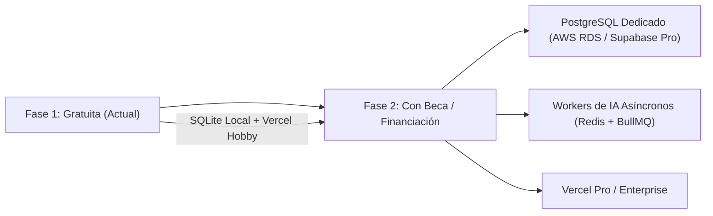

# Guía de Migración al Obtener Financiación o Beca Deportiva

Cuando el proyecto consiga financiación (inversión privada, federación nacional o becas deportivas como CSD/Comité Olímpico), el ecosistema está arquitecturado para escalar a nivel empresarial sin tener que reescribir una sola línea de código.

---

## 1. Hoja de Ruta de Escalabilidad

---

## 2. Pasos para la Migración

### Paso 1: Aprovisionar PostgreSQL Dedicado
En AWS RDS, GCP Cloud SQL o Supabase Pro:
- Activa una instancia con réplica de lectura si el volumen supera los 10,000 atletas concurrentes.
- Obtén la nueva URL de conexión.

### Paso 2: Actualizar la Variable en Vercel
En el panel de Vercel (**Settings -> Environment Variables**):
- Cambia `DATABASE_URL` a la nueva cadena de conexión.
- Vercel redeplegará automáticamente la aplicación con cero tiempo de inactividad (*Zero Downtime Deployment*).

### Paso 3: Escalado del Motor de IA
- Actualmente, el motor de reentrenamiento continuo opera de forma reactiva y rápida.
- Al contar con presupuesto para GPUs, puedes activar un contenedor en **RunPod** o **AWS SageMaker** para fine-tuning de modelos LLM completos usando los datos de combate y pulsaciones exportados desde `/api/v1/reports?format=json`.
